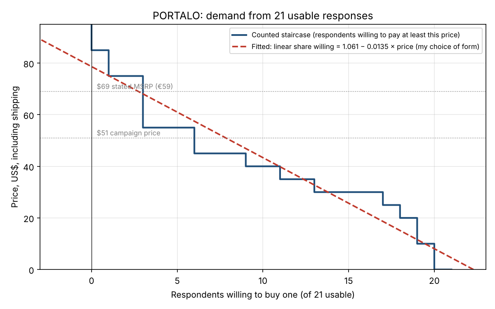

# Demand curve

21 usable responses, yes/no demand: the most each person would pay for one PORTALO, including shipping. Data in responses.csv, cleaning in cleaning.md.

## Checked before reading anything off it

| Number that needs no model | From the data | From the curve |
|---|---|---|
| Respondents | 21 | 21 willing at $0 |
| Typed zeros | 1 | Curve drops from 21 to 20 just above $0 |
| Highest maximum | $85 | Curve reaches 0 just above $85 |

All three match. I also read the table below back line by line against the sorted list of answers in responses.csv.

## 1. Counted: the staircase

Each respondent buys one unit at any price up to their maximum and none above it. The curve at a price is the number of people whose maximum is at least that price. Nothing is interpolated and nobody's answer is used to predict anybody else's. Under yes/no this involves no assumptions.

| Price | Willing to buy one | Share of 21 |
|---|---|---|
| $0 | 21 | 100% |
| $10 | 20 | 95% |
| $20 | 19 | 90% |
| $25 | 18 | 86% |
| $30 | 17 | 81% |
| $35 | 13 | 62% |
| $40 | 11 | 52% |
| $45 | 9 | 43% |
| **$51 (campaign price)** | **6** | **29%** |
| $55 | 6 | 29% |
| $60 | 3 | 14% |
| **$69 (stated MSRP, €59)** | **3** | **14%** |
| $75 | 3 | 14% |
| $80 | 1 | 5% |
| $85 | 1 | 5% |
| Above $85 | 0 | 0% |

## 2. Fitted

**Form: linear in the share willing, chosen by me:** share = 1.061 − 0.0135 × price, fitted by least squares to the staircase at every whole dollar from $0 to $85. I chose linear before looking at alternatives because it is the simplest form and the one the profit model uses. Here an assumption does cross between people: the line lets the three parents at the top shift the predicted share at $30, where only surfers answered.

| Price | Counted | Fitted |
|---|---|---|
| $20 | 19 | 16.6 |
| $30 | 17 | 13.8 |
| $40 | 11 | 11.0 |
| $51 | 6 | 7.8 |
| $60 | 3 | 5.3 |
| $69 | 3 | 2.7 |
| $75 | 3 | 1.0 |
| $85 | 1 | −1.8 |

## 3. Sanity checks

**Does it behave like people?** The staircase does: never negative, never more than 21 even at $0, and zero above $85. **The fitted line fails.** It predicts 22.3 buyers out of 21 at $0, and it goes negative above $78.70, inside my evidence range, because someone did say $85.

**Does it match the staircase?** Only in the middle. It matches at $40 (11.0 against 11). It sits **below** the staircase from $20 to $30, **above** it from $51 to $60 (7.8 against 6 at the campaign price, a 30% overstatement), and below again at the top. That is the "fits the middle, fails at both ends" pattern.

**I traced the failure upstream instead of trying other forms.** The top of the staircase is three parents and two other-outdoors respondents, and the long flat step at $30 is surfers. The sample is two groups with different willingness to pay (see cleaning.md, segment consistency). A single straight line through both is averaging two markets, so it tilts too steep at the bottom and too shallow at the top. A curvier form would hide this, not fix it. The fix is upstream: more parents in the sample, or a separate curve per segment once there are enough parents to draw one.

**Does it predict something I already know?** At $51, the curve says 6 of 21 (29%) would buy. Of the 21, 9 usually have a working shower where they go and 2 already own a rinse kit, so a willing minority of about a quarter to a third seems possible for this crowd. At $10, 20 of 21 would buy. That also seems right for something that costs about what a beach towel does. One thing I noticed: every price anyone gave was a multiple of $5, and nobody said $50. Three people said $45 and three said $55, so the share at $51 (29%) is really the share at $55. If those three had rounded down to $50, it would be 14%. My read at the campaign price is only as precise as people's rounding.

**The edges.** The lowest answer is $0 and the lowest positive one is $10. The highest is $85. My price of interest, $51, sits inside the evidence range, and so does the $69 MSRP. But above $55 there are only three answers, and above $75 one. Every number above $55 on this curve, counted or fitted, rests on one to three people. Above $85 I have no evidence at all, and the fitted line simply carries its slope out into negative territory.

## 4. The profit-maximising price, from the staircase

Taking the count of willing respondents at each price, and per-unit costs from profit/cost-structure.md:

| Cost basis | Per-unit cost | Best price (counted) | Willing at that price | Best price (fitted) |
|---|---|---|---|---|
| Before ordering (landed cost + variable cost), low | $25.36 | $55 | 6 of 21 | $52 |
| Before ordering, high | $43.55 | $75 | 3 of 21 | $61 |
| After ordering, stock already paid for (variable cost only), low | $8.36 | $30 | 17 of 21 | $43.50 |
| After ordering, high | $18.55 | $45 | 9 of 21 | $48.50 |

At low costs, $45 and $55 give almost the same profit (9 buyers or 6). The choice between them turns on two or three people. At high costs, the best price rests on the three people at $75.

## 5. Explaining my own data

How much people liked PORTALO did not predict what they would pay for it, and if anything it ran backwards. The 8 people who rated it 8–10 out of 10 named a median of $32.50, while the 4 who rated it 1–4 named a median of $47.50. The highest price in the whole sample, $85, came from someone who rated it 4 out of 10. My explanation is that people who assumed it would be expensive liked it less. Someone who looks at it and thinks "this costs a lot" judges it harder, and a high price and a low rating come from the same thought. The people who loved it were mostly surfers who seemed to see it as a cool, cheap upgrade to a Gatorade bottle, not something worth real money. Once someone started negative, they also seemed to stay negative and look for reasons not to want it, and the reverse for people who started positive, which fits the person who rated it 1 and would pay $0. I'm not fully confident in this. The low-rating group is only four people, and two of them drive the result: a parent whose son already has a bigger rinse kit, and someone who thought it was a drinks bottle. Across all 21, the relationship is close to zero. What I do believe is the practical point: a high appeal score is not a buyer, so I should not use appeal ratings to predict sales.
