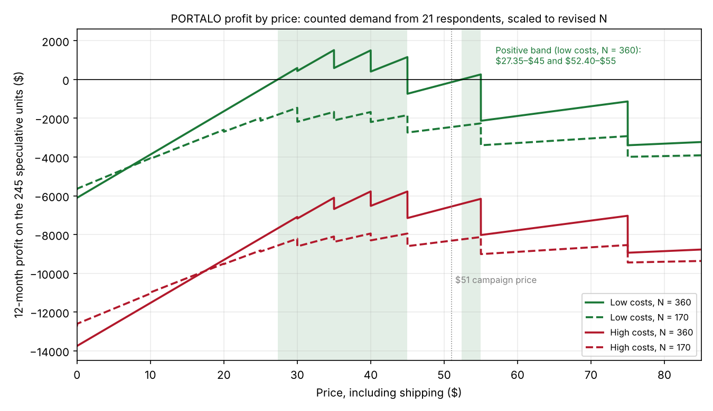

# Profit model

**Headline: the reading changes between the ends of my ranges.** At low costs with the high end of N (360), the 245 speculative units are **fragile**: profit peaks at $1,516 at $35, and the positive band covers 23.8% of the price range, in two separate pieces. In every other case, including low costs with the low end of N (170), they are **impossible**: no price my respondents named covers the commitment. The campaign price of $51 loses money in all four cases, including the best one.

## How it is computed

- **Price range: $0 to $85**, the lowest and highest maximums anyone named. Widths below are shares of that $85 range. Computed every cent.
- **Demand:** the counted staircase from demand/curve.md. At each price, the share of the 21 respondents whose maximum is at or above it, times N. I used the staircase, not the fitted line, because the line failed the sanity checks in Milestone I (it goes negative above $78.70 and predicts 22 buyers out of 21 at $0).
- **Capacity:** sales cannot exceed the 230 units available.
- **Profit** = (price − c at that price) × units sold − f, over 12 months. Inputs and ranges are in inputs.md.

## The reading at the ends of the ranges

| Case | Peak price | Units at peak | Profit at peak | Band where profit > 0 | Width | Reading |
|---|---|---|---|---|---|---|
| Low c and f, N = 360 | $35 | 223 | **+$1,516** | **$27.35–$45.00 and $52.40–$55.00** | $20.25, **23.8%** | **fragile** |
| Low c and f, N = 170 | $30 | 138 | −$1,463 | none | 0% | **impossible** |
| High c and f, N = 360 | $40 | 189 | −$5,776 | none | 0% | **impossible** |
| High c and f, N = 170 | $40 | 89 | −$7,949 | none | 0% | **impossible** |
| Low c, high f, N = 360 | $35 | 223 | −$3,852 | none | 0% | impossible |
| High c, low f, N = 360 | $40 | 189 | −$408 | none | 0% | impossible |

For the impossible cases, "peak" is the price with the smallest loss.

**The band is not contiguous.** In the one positive case, profit goes negative between $45.00 and $52.40 and comes back between $52.40 and $55.00. If I reported the outer edges, $27.35 to $55.00, the width would be 32.5% and the reading would be robust. Reported honestly as two pieces, it is 23.8%, which is fragile. The gap exists because every price anyone named was a multiple of $5 and nobody named anything from $46 to $54. Above $45, the three people who said exactly $45 drop out, and only six people are left until $55.

**The campaign price sits in that gap.** At $51, profit is −$139 even in the best case. At $55, it is +$260 with the same six buyers, because in my data anyone willing at $51 is also willing at $55. That is a rounding effect, not a real reason to prefer $55, but it means my data cannot support $51 specifically.

**Profit by price, at the prices people actually named:**

| Price | Share willing | Low c+f, N 360 | Low c+f, N 170 | High c+f, N 360 | High c+f, N 170 |
|---|---|---|---|---|---|
| $25 | 86% | −$524 | −$1,990 | −$8,201 | −$8,821 |
| $30 | 81% | +$592 | −$1,463 | −$7,091 | −$8,216 |
| $35 | 62% | **+$1,516** | −$1,673 | −$6,103 | −$8,103 |
| $40 | 52% | +$1,502 | −$1,679 | −$5,776 | −$7,949 |
| $45 | 43% | +$1,155 | −$1,843 | −$5,780 | −$7,951 |
| $51 | 29% | −$139 | −$2,454 | −$6,555 | −$8,317 |
| $55 | 29% | +$260 | −$2,265 | −$6,158 | −$8,129 |
| $75 | 14% | −$1,134 | −$2,923 | −$7,033 | −$8,542 |

At $30 and below, the 230-unit cap binds in the best case: more people would buy than I have units.

**Why the best price moved from Milestone I.** curve.md section 4 put the best price at $55 at low costs, because it looked at profit per respondent. Once N, f and the 230-unit cap are in, volume matters: $35 sells 223 units, almost all the stock, and that beats six buyers' worth of higher margin.

## Comparison with my Week 6 N

| N | Low c and f | High c and f |
|---|---|---|
| Week 6: 700 | robust, 56.1%, peak +$4,780 at $55 | impossible |
| Week 6: 2,000 | robust, 67.8%, peak +$10,642 at $75 | fragile, 15.4%, peak +$2,898 at $75 |
| Revised: 360 | fragile, 23.8%, peak +$1,516 at $35 | impossible |
| Revised: 170 | impossible | impossible |

My Week 6 N would have produced a robust reading. It was mostly the Wedge, which I never sampled, so I am not using it. The comparison shows how much of the answer rests on N, which sensitivity.md tests directly.

## What my evidence does not cover

- **Everything above $55 rests on three people:** two at $75 and one at $85. The high-cost case at Week 6's N only turns positive at $62 to $75, which is entirely those three.
- **The second piece of the band ($52.40–$55) rests on six people,** three of whom said exactly $55.
- **If the three parents are unrepresentative** and I drop them (n = 18, same N), the best case stays fragile but the peak falls from $1,516 to $896.
- **If the three $55 answers were really rounded-up $50s,** the second piece of the band disappears and the width falls to 20.8%. Still fragile.

The best case survives these checks, but it only exists at low costs and N of at least 251 (sensitivity.md), and I have measured neither. The honest reading of my data is: **impossible at most of my ranges, fragile at best, and I cannot yet tell which end is real.** What would tell me: a landed-cost quote for 1,000 units, and a count of how many screened-in adults I can actually reach at Torrance in a year.
